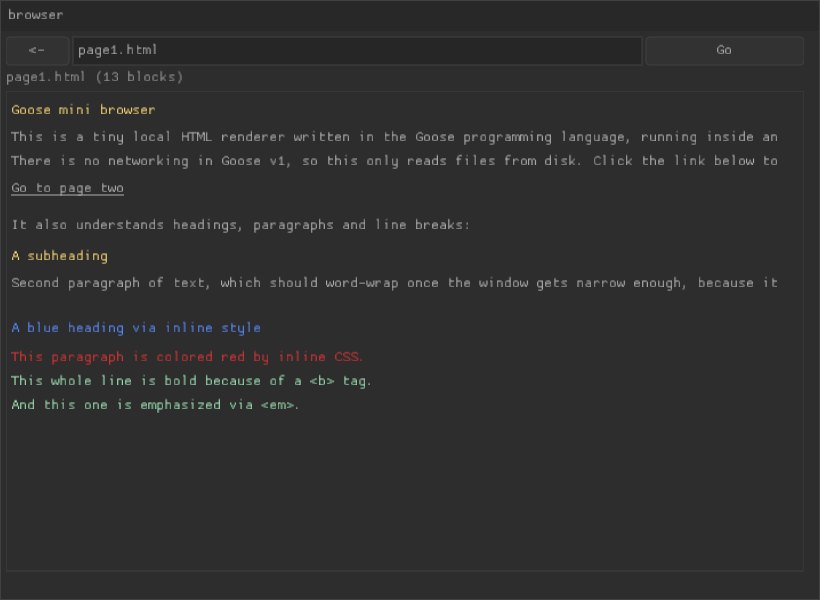

# goose-mini-browser

A tiny graphical web browser built on [Goose](https://github.com/aardappel/goose),
a brand-new memory-safe systems language with no heap/GC — plus a small Rust
sidecar that gives it the one thing its v1 standard library deliberately
doesn't have: networking.



It fetches real pages over `http://` and `https://`, follows redirects,
decodes chunked transfer-encoding, renders basic HTML (headings, paragraphs,
links, line breaks, a handful of inline styles) in a resizable SDL3/Nuklear
window, and lets you click between pages — all without blocking the UI
thread while a request is in flight.

This is a demo/learning project, not a production browser. See
[Limitations](#limitations) for exactly where it stops.

## Why this exists

Goose v1 ships no sockets, no TLS, and no subprocess support by design (see
its `docs/stdlib.md`). Rather than wait for a future version, this project
gives Goose that capability the way its own FFI model intends: a small
Rust `cdylib` exposed through a plain C ABI, dynamically bound from Goose
with `extern "libname" { ... }` — no C toolchain, no cmake, no changes to
the Goose compiler itself.

## Architecture

```
┌─────────────────────────────┐        ┌──────────────────────────┐
│   browser/mini_browser.goose │        │   goosenet (Rust cdylib)  │
│                              │        │                            │
│  HTML scanner/renderer       │  C ABI │  TCP + rustls TLS          │
│  (gfx + ui: SDL3/Nuklear)    │◄──────►│  redirect following        │
│  thread_fn worker + queues   │        │  chunked-encoding decode   │
│  for non-blocking fetches    │        │  one function: fetch(url)  │
└───────────────┬──────────────┘        └──────────────────────────┘
                │ extern "goosenet" { ... }   (dlopen'd at runtime,
                │                              resolved via .build sidecar)
                ▼
        libgoosenet.{dylib,so,dll}
```

- **`goosenet/`** — the Rust side. One exported entry point,
  `goosenet_fetch(url) -> (status, body)`, that resolves scheme, opens a raw
  TCP socket or a `rustls` TLS connection, follows up to 8 redirects, and
  undoes `Transfer-Encoding: chunked`. Everything crosses the FFI boundary
  as scalars and raw pointers (see `docs/` link below for the exact rules);
  an owned buffer is handed back as a `u64` + length and freed by the Goose
  side calling `goosenet_free` after copying it out.
- **`browser/net.goose`** — a thin Goose wrapper: `extern "goosenet" { ... }`
  binds the two functions dynamically (no C compiler involved on the Goose
  side), and `http_get_page` does the FFI call and copies the result into
  Goose-owned memory.
- **`browser/mini_browser.goose`** — the browser itself:
  - a hand-rolled HTML scanner (not a real parser) for `<h1-h3>`, `<p>`,
    `<a href>`, `<br>`, `<b>/<strong>/<i>/<em>`, and inline `style="color: ..."`
  - HTML entity decoding (`&amp;`, `&lt;`, numeric `&#NN;`/`&#xHH;`, …)
  - a `thread_fn` worker consuming jobs off a typed queue
    (`qget`/`qput`/`qpoll` — Goose has no shared memory between threads) so
    a slow fetch never freezes the window
  - a Nuklear UI: address bar, back button, scrollable page view, clickable
    links
- **`browser/mini_browser.build`** — the sidecar that maps `goosenet` to
  `./goosenet` next to the built executable (resolved through
  `resource_dir()`), so the shipped binary needs no `DYLD_LIBRARY_PATH` /
  `LD_LIBRARY_PATH` / `PATH` setup to find its own library.

## Prerequisites

- **Rust** (`cargo`/`rustc`) — any recent stable toolchain.
- **A `goose` compiler**, built from source (there is no package yet):

  ```bash
  git clone --depth 1 https://github.com/aardappel/goose.git
  cd goose
  cmake -B build -DCMAKE_BUILD_TYPE=Release -DGOOSE_BUILTIN_LIBS=all   # brew install cmake if needed
  cmake --build build -j8
  ```

  `-DGOOSE_BUILTIN_LIBS=all` compiles the `gfx`/`ui` packages (SDL3 +
  Nuklear) straight into the compiler, which this project needs.
- A C compiler on `PATH` (`cc`/`clang`/`gcc`) — `goose build` needs one, and
  so does this project: **threads require AOT compilation**, the in-process
  JIT backend (`goose run`) cannot place thread-local storage.

## Build

```bash
git clone <this-repo>
cd goose-mini-browser
GOOSE_BIN=/path/to/goose/build/goose ./build.sh
```

`build.sh` compiles `goosenet` in release mode, copies the resulting shared
library next to `browser/mini_browser.goose`, and runs `goose build` to
produce a standalone `browser/mini_browser` executable.

## Run

```bash
./browser/mini_browser "https://example.com/"
./browser/mini_browser browser/page1.html     # a bundled local demo page
```

- Type a URL or path in the address bar and press **Go**, or click a link.
- **←** goes back through history.
- **Esc** or closing the window quits.
- `-- --frames N` renders exactly `N` frames and exits (used for headless
  screenshot testing — see `GOOSE_GFX_HEADLESS=1` below).

## Headless testing

```bash
GOOSE_GFX_HEADLESS=1 ./browser/mini_browser "https://example.com/" --frames 300
```

opens no real window, runs the given number of frames, and saves
`mini_browser.png` on exit — useful for CI or for verifying a change
without eyeballing a live window.

## Limitations

This is a learning project built to see how far Goose + a minimal Rust FFI
shim can go, not a spec-compliant browser. Known, intentional gaps:

- **No CSS layout.** `style="color: ..."` and `<b>/<strong>/<i>/<em>` are
  recognized and change text color (there's no second font loaded, so true
  bold/italic glyphs aren't rendered), applied per block, not per inline
  span. No box model, no flexbox/grid, no positioning.
- **No JavaScript.** Pages that render their content client-side (most
  modern web apps, social feeds, SPAs) show nothing meaningful.
- **No cookies/sessions.** Every request is anonymous; anything requiring
  login won't show authenticated content.
- **No images.** `` is ignored.
- **gzip/deflate aren't decoded** — pages that insist on compression
  despite no `Accept-Encoding` header may render as binary noise.
- **The HTML scanner is not a real parser**: no error recovery beyond
  "ignore anything it doesn't recognize," no `<table>`/`<ul>`/`<ol>`
  support, no handling of malformed markup beyond what falls out naturally.
- **URL resolution is "same directory" only** — no `..`, no full RFC 3986
  resolution.

## License

MIT — see [LICENSE](LICENSE).

## Acknowledgments

Built on [Goose](https://github.com/aardappel/goose) by Wouter van
Oortmerssen — a systems language with no heap allocator, garbage collector,
or lifetime annotations, whose compiler was largely written by an AI
working from his architecture and design. Networking is handled by
[rustls](https://github.com/rustls/rustls) and
[webpki-roots](https://github.com/rustls/webpki-roots).
